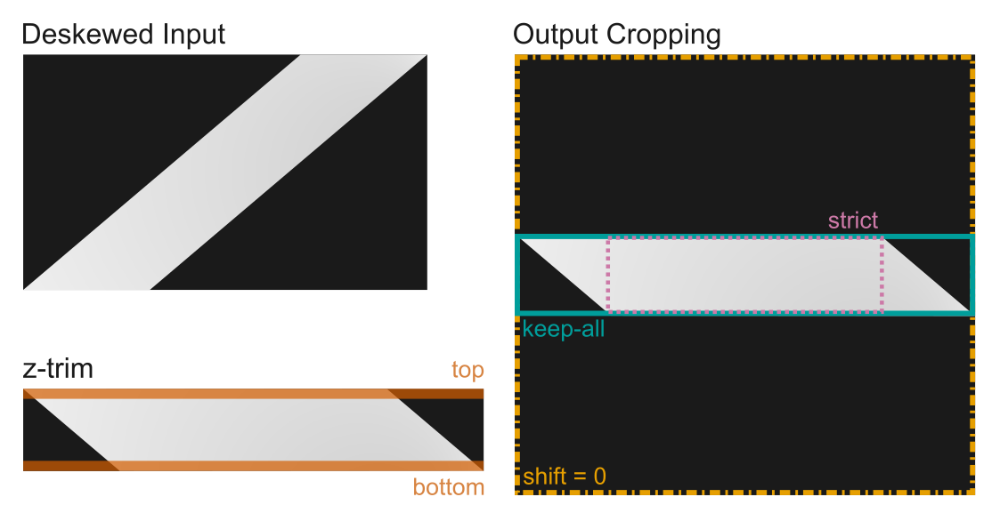

# Rotation
{: .no_toc }

The `rotate` module rotates an image stack about the y axis to move it from the objective frame into the coverslip frame. After [deskewing](https://aicjanelia.github.io/LLSM/deskew/deskew.html), x and y lie in the objective plane and z is the objective normal; rotating by the objective angle makes z the coverslip normal. It is typically run after deskewing (and after deconvolution, if requested).

## Table of Contents
{: .no_toc .text-delta }

1. TOC
{:toc}

## Rotate Ordering

Each rotated stage is written to its own folder, named `rotate_` plus the name of the folder it was made from, so it is clear how the pipeline was run:

| Rotated stage (`stages` name) | Source folder | Output folder |
| ----- | ----- | ----- |
| `deskew` | `deskew/` | `rotate_deskew/` |
| `decon` (deconvolved after deskewing) | `decon/` | `rotate_decon/` |
| `deskew_after_decon` (`decon-first`) | `deskew_after_decon/` | `rotate_deskew_after_decon/` |
| none enabled | unprocessed (or cropped/flatfielded) images | `rotate/` |

By default the last stage of each chain is rotated: `decon` if deconvolution is enabled after deskewing, otherwise `deskew`, plus `deskew_after_decon` if `decon-first` is enabled. A configuration with both `deskew` and `decon-first` therefore rotates both chains separately. To rotate more than one stage of a chain (for example both the deskewed and the deconvolved images), list them with `stages`: `"stages": ["deskew", "decon"]`. When `stages` is given it replaces the default, so list every stage you want rotated. A stage can only be listed if the module that makes it is enabled.

## Angle and sign conventions

`rotate -a θ` rotates the image **content** with the matrix

```
[  cos θ   0   sin θ ]
[    0     1     0   ]
[ -sin θ   0   cos θ ]
```

applied to physical (calibrated) coordinates, so x&prime; = x cos θ + z sin θ and z&prime; = -x sin θ + z cos θ. The rotation is done in micrometers, so the anisotropy of the data (xy pixels smaller than the z step) is accounted for. The y axis is the rotation axis and is not changed.

| Microscope | Rotation angle | Deskew angle |
| ----- | ----- | ----- |
| MOSAIC | -32.45 | 147.55 |
| LLSM | 31.8 | 31.8 |

Note that on the MOSAIC the rotation angle is -32.45, not the 147.55 used for deskewing; the two differ by 180&#176;. Any other angle can be used if there is an experimental reason to rotate by something else.

## Output size and spacing

The rotated volume is resampled once with linear interpolation. By default the output is **isotropic**: cubic voxels the size of the xy pixel (for example 0.108 x 0.108 x 0.108 &#956;m on the MOSAIC). Because the z spacing of deskewed data is coarser, the decrease in file size from cropping away empty regions of the image is offset by the increase in file size from changing the voxel sizes. Output voxel centers sit on a grid of integer multiples of the output spacing, relative to input voxel (0,0,0) and the absolute position of the output is not preserved.

The output voxel size is set with `--output-spacing` (`"output-spacing"` in the configuration file), in &#956;m:

| Value | Output voxels |
| ----- | ----- |
| not given (default) | Cubic at the size of the input xy pixel (e.g., 0.108 x 0.108 x 0.108 &#956;m). |
| `input` | The voxel size of the input (e.g., 0.108 x 0.108 x 0.268 &#956;m). This decreases file sizes at the expense of resolution. |
| one number, `S` | Cubic voxels of `S` &#956;m (e.g., `0.15`). |
| three numbers, `X,Y,Z` | Anisotropic voxels, in x, y, z order (e.g., `0.15,0.15,0.2`). On the command line separate the values with commas without spaces; in the configuration file use a list (`[0.15, 0.15, 0.2]`). |

The y axis is the rotation axis, so the y extent of the image does not change, but it is resampled when the output y spacing differs from the input. The pipeline writes warnings when the output spacing along any axis is finer than the smallest input spacing, normally the xy pixel size (oversampling adds no information and enlarges the file, in proportion to 1/(X&#183;Y&#183;Z)) or coarser than the input z spacing (the coarsest input axis; downsampling by linear interpolation without smoothing can introduce aliasing). The default and `input` never warn. Output spacings with different x and y values cannot be combined with the `mip` section, because the `mip` module uses a single xy pixel size; the pipeline stops with an error in that case.

## Cropping

Two cropping modes are available with `--crop-mode` (`"crop-mode"` in the configuration file):

| Mode | Output region |
| ----- | ----- |
| `keep-all` (default) | The bounding box of the valid data. The empty triangles created by deskewing are not included, but black space around the rotated data is. See the solid teal line the output cropping schematic.|
| `strict` | The largest rectangle that contains only valid data (no empty space). Only available when the rotation angle matches the deskew geometry (e.g., MOSAIC -32.45 after deskewing at 147.55). See dashed magenta line in the output cropping schematic. |

Both modes need to know where the valid data are. The pipeline passes the deskew shift (`--shift`, in pixels per z plane, `step*cos(deskew angle)/xy-res`, negative on the MOSAIC) to `rotate` automatically. When running `rotate` by hand on deskewed data, supply it yourself; without `--shift` the whole array is treated as valid data and `strict` is not available. On deskewed input with shift unspecified or set to zero, the empty deskew triangles are then rotated and included in the `keep-all` bounding box, which shows up as many extra, empty z slices, greatly increasing file size (see the dot-dashed orange line in the output cropping schematic below). `rotate` prints a warning when `--shift` is not given; pass `--shift 0` explicitly if the input really is not deskewed.

### Removing edge slices

Some experiments show edge effects in the first or last z slices of the rotated volume. `--z-trim` (`"z-trim"` in the configuration file) removes output z slices after the crop mode has been applied, and works with both `keep-all` and `strict`. Give one non-negative integer to remove that many slices from both ends, or two (`bottom,top` on the command line, `[bottom, top]` in the configuration file) to trim each end separately. If an image were opened in Fiji, `top` corresponds to the first z-slice, while `bottom` corresponds to the last. The default is 0. The trimmed slices are never computed, and every channel and timepoint receives the same trimmed grid when processed with the pipeline. Slices are counted in the output, so their thickness is the output z spacing. `rotate` stops with an error if the trim would remove every slice.



## Memory

Images are processed as double-precision numbers in memory, so a 2075 x 1500 x 401 stack needs about 10 GB for the input, plus the output (about 2 GB for `strict`, more for `keep-all`). Request enough slots in the `bsub` section of the configuration file (15 GB per slot); the deconvolution memory estimate in [Configuration File](https://aicjanelia.github.io/LLSM/pipeline/config.html#slots) does not apply to `rotate`.

## Usage

### Pipeline: Configuration File
This is an example portion of a configuration file for a MOSAIC acquisition that is deskewed and then rotated. The strict crop-mode will remove some of the data, and z-trim will remove 2 z-slices from each size. The data will be samples with isotropic 0.2 &#956;m voxels in the output file.

```json
"deskew": {
    "xy-res": 0.108,
    "fill": 0.0,
    "bit-depth": 16,
    "angle": 147.55
},
"rotate": {
    "angle": -32.45,
    "stages": ["deskew"],
    "crop-mode": "strict",
    "z-trim": [2, 2],
    "output-spacing": 0.2,
    "fill": 0.0,
    "bit-depth": 16
}
```

The xy pixel size and step size come from the `deskew` (or `decon-first`) section and the settings file. When `rotate` is used on its own, `xy-res` can be given in the `rotate` section; the z step is read from the settings file. Rotated images are saved in the folders described above, with MIPs in `mip/<folder>` if requested. All parameters are optional.

### Command Line Example
The command below rotates a deskewed MOSAIC image into the coverslip frame, keeping only valid data. The z spacing is `step*sin(angle)` (0.2683 &#956;m for a 0.5 &#956;m step) and the shift is `0.5*cos(147.55&#176;)/0.108 = -3.9068` pixels.
```
rotate -a -32.45 -x 0.108 -z 0.2683 --shift -3.9068 -c strict -w -o scan_ch00_tile0_t0000_rotate.tif scan_ch00_tile0_t0000_deskew.tif
```

### Rotate Options
```
rotate: rotates an image stack about the y axis (e.g., from the objective to the coverslip frame)
usage: rotate [options] path

Allowed options:
  -h [ --help ]                      display this help message
  -a [ --angle ] arg                 rotation angle about the y axis (degrees),
                                     BigStitcher y-axis convention (MOSAIC:
                                     -32.45)
  -x [ --xy-res ] arg (=-1)          x/y resolution of the input (um/px);
                                     default is read from the input file
  -z [ --z-res ] arg (=-1)           z resolution of the input (um/px), i.e.
                                     step*sin(angle) after deskewing; default
                                     is read from the input file
  -d [ --shift ] arg (=0)            signed deskew shift (px per z plane) =
                                     step*cos(deskew angle)/xy-res; needed for
                                     strict cropping, 0 treats the whole array
                                     as valid
  -c [ --crop-mode ] arg (=keep-all) keep-all (bounding box of the valid data)
                                     or strict (largest fully valid region;
                                     needs --shift and a matching angle)
  --z-trim arg (=0)                  output z slices to remove after cropping,
                                     to avoid edge effects: N (both ends) or
                                     bottom,top (e.g. 2,3)
  --output-spacing arg               output voxel spacing (um): S (cubic
                                     voxels), X,Y,Z, or 'input' to keep the
                                     input spacing; default is cubic voxels the
                                     size of the input xy pixel
  -f [ --fill ] arg (=0)             value used to fill empty regions
  -o [ --output ] arg                output file path
  -b [ --bit-depth ] arg (=16)       bit depth (8, 16, or 32) of output image
  -t [ --thread ] arg (=1)           number of threads
  -w [ --overwrite ]                 overwrite output if it exists
  -v [ --verbose ]                   display progress and debug information
  --version                          display the version number
```
